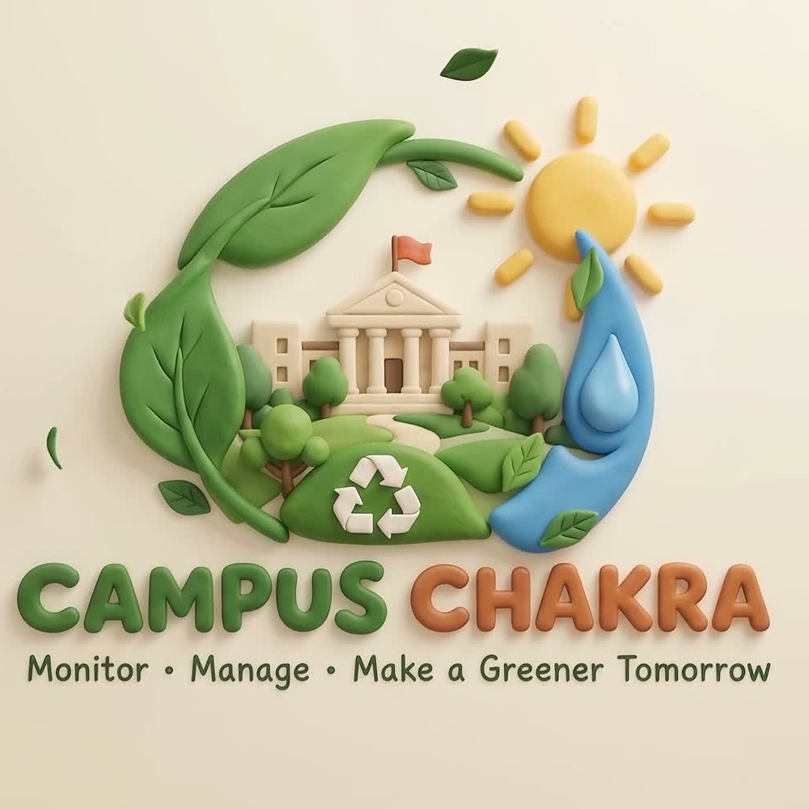

# Campus Chakra: Predictive Circular-Resource Grid

> **Chanakya University · Global Campus (Haraluru–Polanahalli, Devanahalli, Bengaluru)**  
> *Srujana 2026 — Prompt to Product (P2P) | Prompt for the Planet*



Campus Chakra is an AI-driven, edge-native micro-grid and circular resource management platform engineered for institutional university campuses. It unifies real-time edge smart-bin sorting, multi-horizon demand forecasting, automated root-cause anomaly detection, and a grounded Multi-Agent Facilities Copilot.

---

## 🌟 Key Features

1. **Animated Video Logo Reveal & Glassmorphism Design:**
   - Cinematic fullscreen animated logo reveal at startup with smooth entry transitions.
   - Clean, structured frosted-glass design system with ambient dynamic mesh glows and live telemetry pills.
   - Responsive, dark-themed interface built with Plus Jakarta Sans and JetBrains Mono typography.

2. **Real-Time Edge Smart-Bin AI:**
   - On-device waste classification fusing 5 physical sensors (weight, moisture, inductive metal, transparency, acoustic piezo).
   - **86.4% cross-validated accuracy** across 6 waste categories (`food_organic`, `paper_cardboard`, `plastic`, `glass`, `metal`, `ewaste`).
   - Micro-forest model executes in **0.18 ms** directly on microcontroller SRAM / client browser.

3. **12-Hour Proactive Demand Forecasting:**
   - Multi-horizon 6h and 12h building-level active power (kWh) and water (kL) demand forecasting.
   - 14.2% WMAPE and 0.89 Spike F1 score, preventing peak grid tariff surcharges.

4. **Multi-Agent Facilities Copilot:**
   - Canvas-powered **Particle Title** (`particle-title.tsx`) with 6 rotating gather/dissolve physics modes.
   - Interactive **Aura Field** (`aura-field.tsx`) with conic-gradient turning glow and word-by-word streaming soft-blur resolution.
   - Quick Facilities Tools: `✓ Proofread`, `⚡ Action Plan`, `≡ Concise`, `💧 Water Audit`, `☀️ Solar Dispatch`, and Undo history stack.
   - Grounded multi-agent reasoning trace: **NVIDIA Nemotron 70B** (Analyst) → **Groq Llama 3.3** (Planner) → **Gemini 2.5 Flash** (Verifier) with deterministic offline fallback.

5. **Anomaly Sentinel & Root-Cause Attribution:**
   - Automated root-cause isolation for HVAC inefficiencies, pump leaks, and off-hour facility surges.
   - Quantified financial waste impact and carbon emissions estimation.

6. **Eco-Credits & Intermittent Gateway Resilience:**
   - Occupancy-normalized incentive leaderboard driving campus sustainability.
   - Edge buffer simulation for disconnected offline gateways with idempotent syncing.

---

## 📁 Repository Structure

```text
├── backend/
│   ├── anomaly.py           # Anomaly isolation & root-cause attribution
│   ├── app.py               # FastAPI server & API endpoints
│   ├── classifier.py        # Edge smart-bin ML model & training
│   ├── config.py            # Campus constants, building mappings & config
│   ├── db.py                # Supabase cloud DB connection & seeding
│   ├── forecast.py          # 6h & 12h LightGBM / regression demand forecasting
│   ├── incentives.py        # Eco-credits calculation engine
│   ├── ingest.py            # Multi-modal sensor telemetry cleaning & fusion
│   ├── llm.py               # Multi-agent facilities copilot reasoning
│   ├── pipeline.py          # Precomputed pipeline runner
│   └── supabase_schema.sql  # Supabase PostgreSQL relational schema
├── components/
│   └── ui/
│       ├── aura-field.tsx              # Reusable React AuraField component
│       ├── particle-title.tsx          # Reusable React ParticleTitle component
│       ├── shiny-button.tsx            # Reusable React ShinyButton component
│       └── aura-field-utils/
│           └── aura-field.css          # Conic gradient & soft-blur CSS
├── web/
│   ├── index.html           # Campus Chakra production web dashboard
│   ├── styles.css           # Glassmorphism design tokens & styles
│   ├── app.js               # Client interactive engine & Chart.js controllers
│   ├── logo.png             # Official campus logo
│   ├── logo_reveal.mp4      # Animated logo reveal video
│   └── data/
│       └── dashboard.json   # Precomputed campus telemetry stream
├── .env.example             # Configuration template (without sensitive secrets)
├── .gitignore               # Excludes secrets, caches, and build artifacts
├── DEMO_VIDEO_SCRIPT.md     # Production 5-minute video demonstration script
├── PROMPT_WORKBOOK.md       # Prompt-to-Product development workbook
├── REPORT.md                # System Architecture & Technical Evaluation Report
└── README.md
```

---

## 🚀 Quickstart & Running Locally

### 1. Prerequisites
- Python 3.9+
- Modern Web Browser (Chrome, Edge, Safari, Firefox)

### 2. Install Python Dependencies
```bash
pip install fastapi uvicorn pandas numpy scikit-learn lightgbm requests pydantic
```

### 3. Configure Environment Variables (Optional)
Copy the template file:
```bash
cp .env.example .env
```
Add your optional API keys for live LLM providers and live weather (if omitted, Campus Chakra automatically uses its deterministic offline root-cause and heuristic engines):
- `GROQ_API_KEY`: Groq Llama 3.3 Planner
- `OPENROUTER_API_KEY`: NVIDIA Nemotron 70B Analyst
- `OPENWEATHER_API_KEY`: Devanahalli Campus Live Meteorological Observations
- `SUPABASE_URL` & `SUPABASE_KEY`: Supabase Cloud DB Storage

### 4. Start the Application Server
```bash
uvicorn backend.app:app --port 8000
```

### 5. Access the Web Platform
Open your browser and navigate to:
```text
http://localhost:8000
```

---

## 🧩 React / shadcn UI Component Integration

The reusable React components are located in `/components/ui/` matching the standard **shadcn/ui** and Tailwind CSS conventions:
- [`aura-field.tsx`](components/ui/aura-field.tsx): Writing field with AI tools, conic gradient aura, and word-by-word blur stream.
- [`particle-title.tsx`](components/ui/particle-title.tsx): 2D Canvas particle text title with 6 physics dissolve modes.
- [`shiny-button.tsx`](components/ui/shiny-button.tsx): Shimmer CTA button with customizable styling.

### Integrating with a Next.js / Vite Project:
1. Initialize shadcn:
   ```bash
   npx shadcn@latest init
   ```
2. Copy components into your project's `@/components/ui` folder.
3. Import and use directly in your React views:
   ```tsx
   import { ParticleTitle } from "@/components/ui/particle-title";
   import { AuraField } from "@/components/ui/aura-field";

   export default function FacilitiesCopilot() {
     return (
       <div className="flex flex-col items-center gap-6 p-8">
         <ParticleTitle text="Campus Facilities Intelligence" />
         <AuraField theme="dark" />
       </div>
     );
   }
   ```

---

## 📜 License
Built for Chanakya University & Srujana 2026. All rights reserved.
